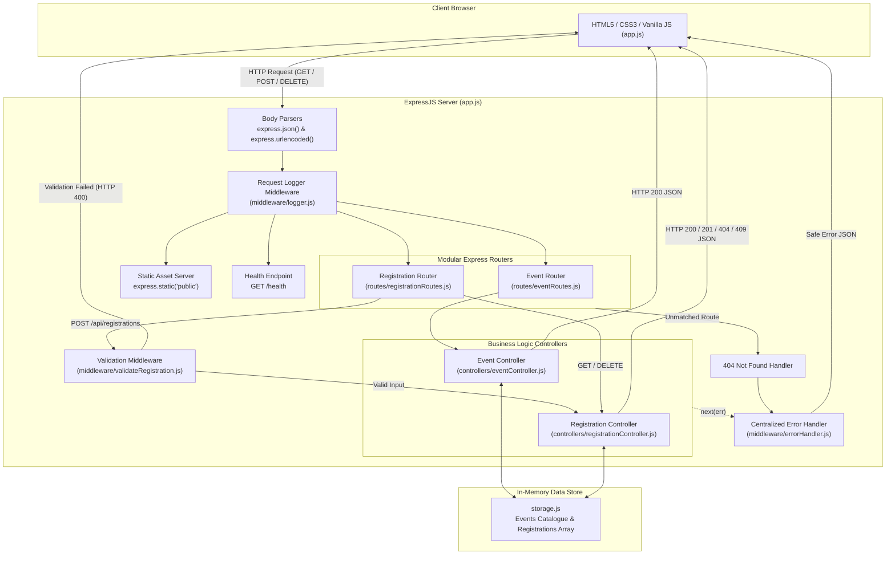

# EventHub — College Event Registration System

> **Academic Practical No. 05** — Web Application Framework: ExpressJS  
> **Course:** Web Technology (Third Year B.Tech / Computer Engineering)  
> **Repository:** `https://github.com/<your-username>/EventRegistrationSystem` *(Placeholder)*  
> **Live Deployment:** `https://<your-app-name>.onrender.com` *(Pending Deployment)*

---

## 1. Project Title
**Event Registration System (EventHub)** — A modular Express.js web application with robust server-side validation and in-memory seat capacity management.

---

## 2. Project Overview
**EventHub** is a full-stack web application developed to demonstrate the core architectural capabilities of the **ExpressJS** web framework under Node.js. It facilitates event discovery, real-time seat availability tracking, participant registrations, and reservation cancellations for college events.

The application emphasizes clean separation of concerns, strict server-side validation, centralized error handling, RESTful routing, and dependency-free automated testing using Node.js's native test runner.

---

## 3. Problem Statement
Modern web applications require reliable server-side validation and structured request/response pipelines to prevent invalid input, ensure system integrity, and provide informative feedback to users. Client-side browser validation can be easily bypassed using developer tools, script injection, or direct HTTP API requests. 

The goal of Practical No. 05 is to:
> *"Design, develop and deploy a web application to demonstrate server-side validation using ExpressJS."*

---

## 4. Objectives
1. Implement a modular ExpressJS application utilizing modern routing (`express.Router()`).
2. Build custom middleware for request logging, data validation, and centralized error handling.
3. Enforce strict server-side validation rules covering input formats, length constraints, event existence, and ticket classifications.
4. Manage event seat capacity dynamically using an in-memory data store with atomic seat reservation and cancellation.
5. Provide a responsive, accessible frontend interface using HTML5, CSS3, and Vanilla JavaScript.
6. Verify all endpoints, middleware pipelines, and validation logic through automated tests.
7. Prepare the application for cloud deployment on Render's free tier.

---

## 5. Key Features
- **Dynamic Event Showcase:** Fetches live college event information (title, date, venue, capacity, available seats) via REST API.
- **Strict Server-Side Validation:** Validates full names, normalized emails, Indian mobile numbers (+91 prefix handling), college names, event existence, and ticket categories.
- **Multi-Error Aggregation:** Returns all validation errors simultaneously in a structured JSON payload rather than failing on the first error.
- **Seat Capacity Management:** Tracks remaining seats in real time and prevents overbooking with HTTP 409 (Conflict).
- **Registration Cancellation:** Allows cancellation of reservations and automatically restores event capacity.
- **Centralized Error Handling:** 4-argument Express error middleware masking internal 5xx errors in production.
- **Responsive UI:** Plain HTML5, CSS3 (CSS Grid & Flexbox), and Vanilla JavaScript with real-time feedback, character counter, and confirmation modals.
- **Zero Database / External Dependencies:** Lightweight in-memory storage and minimal dependencies (`express` and `nodemon`).

---

## 6. Technologies Used
- **Runtime:** Node.js (v24.x / CommonJS)
- **Web Framework:** Express.js (v5.3.0)
- **Development Monitor:** Nodemon (v3.1.14)
- **Testing:** Node.js Native Test Runner (`node:test`, `node:assert/strict`)
- **Frontend:** Semantic HTML5, Modern CSS3 (Variables, Flexbox, Grid), Vanilla JavaScript (ES6+ Fetch API)
- **Version Control & Hosting:** Git, GitHub, Render Web Service

---

## 7. Project Architecture

### Request-Response Flow Diagram



---

## 8. Project Folder Structure

```text
EventRegistrationSystem/
├── .gitignore                      # Git ignore rules for node_modules, logs, and env files
├── package.json                    # Project configuration, scripts, and dependencies
├── package-lock.json               # Deterministic dependency tree lockfile
├── server.js                       # Operational entry point; starts HTTP listener on PORT
├── app.js                          # Express application configuration, middleware, and routes
├── README.md                       # Complete project documentation and academic report
│
├── config/                         # Configuration files (reserved for environment configs)
│
├── controllers/                    # Business logic controllers
│   ├── eventController.js          # Handlers for event listings and single event retrieval
│   └── registrationController.js   # Handlers for create, list, find, and delete registrations
│
├── middleware/                     # Custom Express middleware
│   ├── errorHandler.js             # Centralized 4-argument error-handling middleware
│   ├── logger.js                   # Request logging middleware (method, URL, timestamp)
│   └── validateRegistration.js     # Strict server-side validation middleware
│
├── routes/                         # Express modular routers
│   ├── eventRoutes.js              # Endpoints for /api/events
│   └── registrationRoutes.js       # Endpoints for /api/registrations
│
├── utils/                          # Shared utilities and data models
│   └── storage.js                  # In-memory storage for events catalogue and registrations
│
├── public/                         # Client-side static frontend assets
│   ├── index.html                  # Semantic HTML5 single-page application structure
│   ├── css/
│   │   └── style.css               # Responsive custom stylesheet (pure CSS3)
│   ├── js/
│   │   └── app.js                  # Vanilla JavaScript client (DOM manipulation, Fetch API)
│   └── images/                     # Static image assets (if needed)
│
└── test/                           # Automated test suites (node:test)
    ├── controllers.test.js         # Unit tests for controller logic and HTTP status codes
    ├── middleware.test.js          # Unit tests for validation, logger, and error middleware
    ├── server.test.js              # Integration tests for server pipeline and endpoints
    └── storage.test.js             # Unit tests for storage operations and capacity tracking
```

---

## 9. Application Workflow

1. **Client Request:** The user loads the application at `/`. Express static middleware serves `index.html`, `style.css`, and `app.js`.
2. **Event Catalogue Fetch:** `app.js` issues a `GET /api/events` request. `eventController` returns the 4 college events with remaining seat numbers and capacity metrics.
3. **DOM Generation:** Event cards and the event dropdown are dynamically constructed.
4. **Registration Submission:** The user fills the form. Client-side checks provide immediate feedback.
5. **Server Validation Pipeline:**
   - The form submits a JSON `POST` to `/api/registrations`.
   - `validateRegistration` middleware checks `req.body`.
   - If errors exist, it responds immediately with `HTTP 400` and an array of all detected errors.
6. **Registration Creation:**
   - If valid, control passes to `registrationController.createRegistration()`.
   - `storage.createRegistration()` checks if the event has remaining seats.
   - If full, it responds with `HTTP 409 Conflict`.
   - If space is available, it generates a unique ID (`reg-<uuid>`), sets `registeredAt`, updates the event's `registrationCount`, and returns `HTTP 201 Created`.
7. **Client Confirmation:** The frontend receives the response, shows the confirmation modal, resets the form, and triggers a re-fetch of events to update seat availability.

---

## 10. Server-Side Validation Rules

Server validation is implemented in [`middleware/validateRegistration.js`](file:///F:/College/TY/webtechnology/EventRegistrationSystem/middleware/validateRegistration.js) and is applied before request data reaches the controller:

| Field | Rule Description | Pattern / Constraint | Handling & Normalization |
| :--- | :--- | :--- | :--- |
| **Request Body** | Must be a valid non-null JSON object. | `typeof req.body === 'object' && !Array.isArray(body)` | Rejects non-objects with HTTP 400. |
| `fullName` | Required; 2 to 60 characters; letters, spaces, hyphens, and apostrophes only. | `/^[a-zA-Z\s'-]{2,60}$/` | Trimmed of extra whitespace. |
| `email` | Required; valid RFC-compliant format; max 254 characters. | `/^[^\s@]+@[^\s@]+\.[^\s@]+$/` | Lowercased and trimmed. |
| `phone` | Required; valid 10-digit Indian mobile number starting with 6, 7, 8, or 9. | `/^[6-9]\d{9}$/` | Cleans `+91`, `91`, spaces, and hyphens into standard 10 digits. |
| `college` | Required; 2 to 100 characters. | `length >= 2 && length <= 100` | Trimmed of extra whitespace. |
| `eventId` | Required; must match a valid event in the storage catalogue. | `storage.getEventById(eventId)` | Validates existence in in-memory catalogue. |
| `ticketType` | Required; must be either `Standard` or `Student`. | `['Standard', 'Student']` | Strict enum check. |
| `notes` | Optional; maximum 300 characters. | `length <= 300` | Trimmed; defaults to empty string. |

---

## 11. API Documentation

### 1. Health Check
- **Endpoint:** `GET /health`
- **Description:** Returns server operational health and application status.
- **Response `200 OK`:**
  ```json
  {
    "success": true,
    "appName": "Event Registration System",
    "status": "OK",
    "serverStatus": "running",
    "timestamp": "2026-10-31T00:15:46.285Z"
  }
  ```

### 2. Get All Events
- **Endpoint:** `GET /api/events`
- **Description:** Returns all predefined college events with remaining seat calculations.
- **Response `200 OK`:**
  ```json
  {
    "success": true,
    "message": "Events retrieved successfully",
    "count": 4,
    "data": [
      {
        "id": "evt-1",
        "name": "College Hackathon",
        "description": "24-hour inter-college coding marathon to build innovative software solutions.",
        "date": "2026-11-15",
        "venue": "Auditorium & Computer Labs",
        "capacity": 100,
        "registrationCount": 0,
        "remainingSeats": 100,
        "isFull": false
      }
    ]
  }
  ```

### 3. Get Event by ID
- **Endpoint:** `GET /api/events/:id`
- **Description:** Returns details of a specific event.
- **Response `200 OK`:**
  ```json
  {
    "success": true,
    "data": {
      "id": "evt-1",
      "name": "College Hackathon",
      "capacity": 100,
      "registrationCount": 0,
      "remainingSeats": 100,
      "isFull": false
    }
  }
  ```
- **Response `404 Not Found`:**
  ```json
  {
    "success": false,
    "message": "Event with ID \"evt-999\" not found"
  }
  ```

### 4. Create Registration
- **Endpoint:** `POST /api/registrations`
- **Headers:** `Content-Type: application/json`
- **Request Body:**
  ```json
  {
    "fullName": "Aarav Sharma",
    "email": "aarav.sharma@example.edu",
    "phone": "+91 98765-43210",
    "college": "Government Engineering College",
    "eventId": "evt-1",
    "ticketType": "Student",
    "notes": "Team lead for AI track"
  }
  ```
- **Response `201 Created`:**
  ```json
  {
    "success": true,
    "message": "Registration created successfully",
    "data": {
      "id": "reg-3d2f9a74-9f8a-490b-932d-304bfa3980bc",
      "eventId": "evt-1",
      "eventName": "College Hackathon",
      "fullName": "Aarav Sharma",
      "email": "aarav.sharma@example.edu",
      "phone": "9876543210",
      "college": "Government Engineering College",
      "ticketType": "Student",
      "notes": "Team lead for AI track",
      "registeredAt": "2026-10-31T00:15:46.302Z"
    }
  }
  ```
- **Response `400 Bad Request` (Validation Failure):**
  ```json
  {
    "success": false,
    "message": "Validation failed",
    "errors": [
      "Full name must be between 2 and 60 characters",
      "A valid email address is required"
    ]
  }
  ```
- **Response `409 Conflict` (Capacity Full):**
  ```json
  {
    "success": false,
    "message": "Event \"AI & Machine Learning Workshop\" is already at full capacity (60 seats)."
  }
  ```

### 5. Get All Registrations
- **Endpoint:** `GET /api/registrations`
- **Description:** Returns all registered participants.
- **Response `200 OK`:**
  ```json
  {
    "success": true,
    "message": "Registrations retrieved successfully",
    "count": 1,
    "data": [
      {
        "id": "reg-3d2f9a74-9f8a-490b-932d-304bfa3980bc",
        "eventName": "College Hackathon",
        "fullName": "Aarav Sharma",
        "email": "aarav.sharma@example.edu",
        "phone": "9876543210"
      }
    ]
  }
  ```

### 6. Get Registration by ID
- **Endpoint:** `GET /api/registrations/:id`
- **Description:** Returns a specific participant registration.
- **Response `200 OK`:** Returns matching registration object.
- **Response `404 Not Found`:** If registration ID does not exist.

### 7. Delete / Cancel Registration
- **Endpoint:** `DELETE /api/registrations/:id`
- **Description:** Cancels registration and restores seat availability for the event.
- **Response `200 OK`:**
  ```json
  {
    "success": true,
    "message": "Registration cancelled successfully",
    "data": {
      "id": "reg-3d2f9a74-9f8a-490b-932d-304bfa3980bc",
      "eventId": "evt-1"
    }
  }
  ```
- **Response `404 Not Found`:** If registration ID does not exist.

---

## 12. HTTP Status Codes

| Status Code | Meaning | Context of Usage |
| :--- | :--- | :--- |
| **`200 OK`** | Standard Success | Successful retrieval of events, registrations, health status, and cancellation |
| **`201 Created`** | Resource Created | Successful participant registration |
| **`400 Bad Request`** | Validation Error | Malformed body, missing required fields, or failed format validation |
| **`404 Not Found`** | Resource Missing | Non-existent event ID, registration ID, or unknown route |
| **`409 Conflict`** | State Conflict | Registration attempt for an event that has reached full capacity |
| **`500 Internal Error`** | Server Failure | Unhandled server error (stack traces masked in production) |

---

## 13. Installation Requirements
- **Node.js:** v18.0.0 or higher (v24.x recommended)
- **npm:** v9.0.0 or higher
- **Modern Web Browser:** Chrome, Firefox, Edge, Safari
- **Git:** For version control and deployment

---

## 14. Installation and Setup Instructions

1. **Clone the repository:**
   ```bash
   git clone https://github.com/<your-username>/EventRegistrationSystem.git
   cd EventRegistrationSystem
   ```

2. **Install project dependencies:**
   ```bash
   npm install
   ```

3. **Verify installation:**
   ```bash
   node -v
   npm -v
   ```

---

## 15. How to Run the Application

### Development Mode (with hot-reload via nodemon)
```bash
npm run dev
```
The server will start on `http://localhost:3000` with active file watching.

### Production Mode
```bash
npm start
```
Runs `node server.js` bound to `process.env.PORT || 3000`.

Open your browser and navigate to:
```text
http://localhost:3000
```

---

## 16. How to Run Automated Tests

The project utilizes Node.js's native test runner (`node:test`), eliminating external testing framework overhead:

```bash
npm test
```

This runs all 4 test suites:
- `test/storage.test.js`
- `test/middleware.test.js`
- `test/controllers.test.js`
- `test/server.test.js`

---

## 17. Testing Results

All 48 unit and integration tests execute and pass without errors:

```text
> eventregistrationsystem@1.0.0 test
> node --test

▶ Controller Tests (11 tests passed)
  ✔ Event Controller: getAllEvents, getEventById, 404 handler
  ✔ Registration Controller: createRegistration, capacity full check, getAllRegistrations, getById, deleteRegistration, capacity restoration

▶ Middleware Tests (19 tests passed)
  ✔ Registration Validation: Required fields, full name regex, email format, Indian phone formats, college length, ticket types, notes limit, body object check
  ✔ Request Logger: Method, URL, timestamp logging without interruption
  ✔ Centralized Error Handler: 500 masking in production, 503 handling, 4xx message preservation, custom status codes, headersSent delegation

▶ Server Application Integration Tests (8 tests passed)
  ✔ GET /health: Health status and app metadata
  ✔ GET /api/events: Catalogue retrieval
  ✔ GET /api/events/evt-1: Single event
  ✔ GET /api/events/invalid-id: 404 response
  ✔ GET /api/unknown-endpoint: Route not found handler
  ✔ POST /api/registrations: Invalid payload rejection (400)
  ✔ POST /api/registrations: Valid payload creation (201)
  ✔ GET /api/registrations: Retrieval after creation

▶ In-Memory Storage Utility Tests (10 tests passed)
  ✔ Event Catalogue: Predefined event initializations, lookup by ID, capacity status
  ✔ Registrations: Creation, UUID generation, retrieval, deletion, capacity overflow prevention

ℹ tests 48
ℹ suites 11
ℹ pass 48
ℹ fail 0
ℹ cancelled 0
ℹ skipped 0
ℹ duration_ms 453ms
```

---

## 18. In-Memory Storage Explanation and Limitations

### Implementation
The data store in [`utils/storage.js`](file:///F:/College/TY/webtechnology/EventRegistrationSystem/utils/storage.js) maintains data in Node process memory:
- `events`: Array of event objects initialized with 4 predefined college events.
- `registrations`: Array of active registrations.

### Characteristics & Limitations
- **Speed:** Instant read and write operations without disk I/O or network query latency.
- **Simplicity:** Zero database server configuration or credential management required.
- **Volatility:** **Data is stored strictly in RAM.** Whenever the server restarts, crashes, or is redeployed on Render, memory resets back to the initial catalogue and registrations are cleared.
- **Horizontal Scaling Limitation:** In-memory storage cannot be shared across multiple server worker instances without an external cache like Redis.

*(For a college practical demonstration, in-memory storage satisfies all requirements cleanly without incurring database setup or cloud hosting charges).*

---

## 19. Deployment Instructions for Render

1. **Push your code to GitHub:**
   ```bash
   git init
   git add .
   git commit -m "feat: complete Event Registration System for Practical 05"
   git branch -M main
   git remote add origin https://github.com/<your-username>/EventRegistrationSystem.git
   git push -u origin main
   ```

2. **Create a Free Web Service on Render:**
   - Sign in to [Render](https://render.com/).
   - Click **New +** &rarr; **Web Service**.
   - Connect your GitHub account and select the `EventRegistrationSystem` repository.

3. **Configure Service Settings:**
   - **Name:** `event-registration-system` (or your preferred unique name)
   - **Region:** Choose the closest region (e.g., Singapore, Frankfurt)
   - **Branch:** `main`
   - **Root Directory:** Leave blank (root)
   - **Runtime:** `Node`
   - **Build Command:** `npm install`
   - **Start Command:** `npm start`
   - **Instance Type:** `Free`

4. **Deploy & Verify:**
   - Click **Create Web Service**.
   - Render will build dependencies and start the app with `npm start`.
   - Once deployed, visit your live URL: `https://<your-app-name>.onrender.com`.
   - Verify health at `https://<your-app-name>.onrender.com/health`.

---

## 20. Future Enhancements
- **Persistent Database:** Integrate MongoDB / PostgreSQL with Prisma or Mongoose.
- **Authentication & RBAC:** Implement JWT authentication with Admin and Student roles.
- **Email Confirmation:** Send automated registration confirmation emails with QR code admission passes via Nodemailer.
- **Admin Dashboard:** Visual metrics for event coordinators (charts, ticket revenue, participant export to CSV/Excel).
- **Payment Gateway:** Integration with Razorpay / Stripe for paid ticket categories.

---

## 21. Conclusion
Practical No. 05 successfully demonstrates the end-to-end development of an ExpressJS web application. Through modular design, custom middleware pipelines, rigorous server-side validation, RESTful API routing, and dependency-free automated tests, the application establishes a solid architectural foundation that adheres to software engineering best practices.

